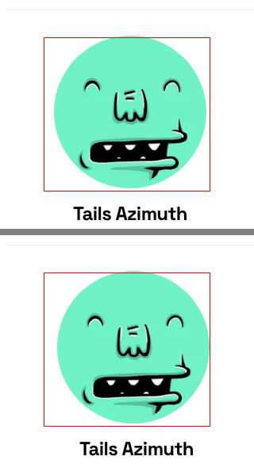
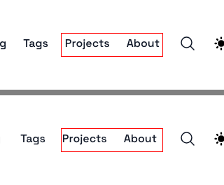

# Case study: a real Tailwind v3 → v4 migration

This is the first time renderdiff was pointed at someone else's real migration rather than
its own test fixtures. Everything below is copied from actual runs; output is trimmed (long
`crops` lists and `dom` lines cut), never edited.

## The site and the migration

[timlrx/tailwind-nextjs-starter-blog](https://github.com/timlrx/tailwind-nextjs-starter-blog),
a popular Next.js + Tailwind blog template. In February 2025 it moved from Tailwind v3 to v4
in two merged PRs:

- [#1111](https://github.com/timlrx/tailwind-nextjs-starter-blog/pull/1111) "migrate core
  config to tailwind v4" (`tailwind.config.js` → CSS `@theme`, PostCSS plugin, token renames)
- [#1122](https://github.com/timlrx/tailwind-nextjs-starter-blog/pull/1122) "refactor:
  migrate to tailwind v4" (class renames across components)

Reference (right): `0a443f2^`, the last v3 commit. Change (left): `7f29c99`, the merge of
#1122. Both are on Next 15.1.4, so the framework is held constant and the diff is the
Tailwind migration plus whatever the PRs touched. Both were production-built and served
locally, which the skill recommends for dependency upgrades: same content, fonts and data on
both sides.

```bash
git clone https://github.com/timlrx/tailwind-nextjs-starter-blog repo && cd repo
git worktree add ../before 0a443f2^ && git worktree add ../after 7f29c99
(cd ../before && yarn install --immutable && yarn build && npx next start -p 3002) &
(cd ../after  && yarn install --immutable && yarn build && npx next start -p 3001) &
```

Install plus build is about a minute per side.

## Routes

Eleven routes, one per layout plus a few long posts with code, tables and math:

```bash
R=(/ /about /blog /blog/page/2 /projects /tags /tags/markdown /blog/code-sample \
   /blog/github-markdown-guide /blog/deriving-ols-estimator /blog/new-features-in-v1)
renderdiff http://localhost:3001 http://localhost:3002 "${R[@]}"
```

That is 55 shots at the default widths (1440, 1152, 896, 704, 375). renderdiff 0.3.0, Node
26, Chromium, an 18-core Mac.

## Run 1: what the migration changed

18 seconds wall clock.

```
Routes: 11
/  clean @375
  @1440,1152  99.96%–99.97%  band +48@y~1719  band -44@y~1721  band +24@y~1827  band -28@y~1827  aligned 99.96%  2–3 reg
    dom @1440 div.no-scrollbar.hidden gap normal 16px→normal, margin-right 24px→0px
/about
  @1440,1152,896,375  98.54%–99.37%  3–5 reg
    dom @1440 img.h-48.w-48 margin-right 8px→0px, border-top-color oklch(0.928 0.006 264.531)→rgb(229, 231, 235); h3.pt-4.pb-2 margin-right 8px→0px, margin-left 0px→8px; …
  @704  ERROR page.addStyleTag: Loading the script 'https://cloud.umami.is/script.js' violates the following Content Security Policy directive: …
/blog  clean @375
  @1440,1152,896,704  99.94%–99.97%  2–3 reg
    dom @1440 div.no-scrollbar.hidden gap normal 16px→normal, margin-right 24px→0px; a[href="/blog"].m-1.font-medium color oklch(0.21 0.034 264.665)→rgb(17, 24, 39), …; a[href="/tags"].m-1.font-medium margin-right 4px→0px, margin-left 4px→24px
…
/blog/github-markdown-guide
  @1440,1152,896,704,375  99.31%–99.75%  h-1  unaligned  71–75 reg
    dom @1440 div.relative:nth-of-type(5) color oklch(0.373 0.034 259.733)→rgb(55, 65, 81), …; #images line-height 31.9999px→32px, …
/blog/new-features-in-v1
  @1440,1152,896,704  99.18%–99.52%  120–126 reg
    dom @1440 p:nth-of-type(32) color oklch(0.373 0.034 259.733)→rgb(55, 65, 81), border-top-color oklch(0.928 0.006 264.531)→rgb(229, 231, 235); …
  @375  98.69%  h-1  unaligned  104 reg
renderdiff: 11 of 11 routes differ (48 of 55 shots), 1 error, worst 98.54% /about@375
```

Every route differs, and every score is above 98.5%. Read by score alone this is "basically
the same". It took reading the `dom` lines and about a dozen crops to sort it into three
kinds of change.

### 1. A real regression on /about: Tailwind v4's new `space-x` selector



The `dom` line says it exactly: `img.h-48.w-48 margin-right 8px→0px` and
`h3 margin-left 0px→8px` (left value first). The author card is
`flex flex-col items-center space-x-2`. In v3, `space-x-2` put `margin-left` on every child
but the first; v4 changed the selector to put `margin-right` on every child but the last. In
a centred column, that moves the avatar 4px left and the name 4px right of where they were.
Nobody would see this in a review of the class-rename diff: the line didn't change. It's
still on upstream `main` today.

Fix (on my local copy): `space-x-2` → `*:not-first:ml-2`, which is the v3 selector spelled
in v4.

### 2. A real, smaller regression in the header nav



#1122 rewrote the nav from `space-x-4 sm:space-x-6 pr-2` to `gap-x-4` with an `sm:-mr-6` on
the parent to compensate for the same `space-x` change. Close, but not exact: the first link
lost 4px after it, and the container lost 4px of trailing space, so "Blog" moved 4px at
`sm`+ and, at 704 (where the nav is a 160px scroll box), every link after "Blog" moved 4px
left. The `dom` line named the container and the margins (`gap normal 16px→normal`,
`margin-left 4px→24px`); I measured link positions to get the arithmetic right. It took two
tries: the first fix (`pr-1`) cleaned 1440–896 but not 704; `--rerun-failed` showed that
in 15 seconds, and adding `first:mr-2` to the links cleaned it.

### 3. Palette and sub-pixel noise, accepted

The rest is two things the v4 migration does on purpose:

- **The oklch palette.** #1111 copied v4's default palette into `@theme`, so `gray-700` is
  now `oklch(0.373 0.034 259.733)` instead of `rgb(55, 65, 81)`. That's a 1–2 unit change per
  channel.
- **Sub-pixel line heights.** Prose line heights compute to `24.0001px` and `31.9999px`
  instead of `24px` and `32px`. On long posts that adds up to a 1px height difference (`h-1`)
  and glyphs a fraction of a pixel off, which is what all those regions on the long posts
  are. The crops look identical to the eye.

After looking at crops for each, I accepted them:

```bash
renderdiff http://localhost:3001 http://localhost:3002 "${R[@]}" --rerun-failed \
  --accept "Tailwind v4 oklch palette and sub-pixel prose line-height (24.0001px); checked crops, invisible"
```

## Final state

A fresh full run (not a rerun) after the two fixes and the accept, 14 seconds:

```
Routes: 11
clean: / /about /blog /blog/page/2 /projects /tags /tags/markdown
accepted: /blog/code-sample
/blog/github-markdown-guide
  @1440,1152,896,704,375  99.31%–99.76%  h-1  unaligned  69–73 reg
/blog/deriving-ols-estimator  accepted @1440,1152,896,704
  @375  ERROR page.addStyleTag: Loading the script 'https://cloud.umami.is/script.js' violates …
/blog/new-features-in-v1  accepted @1440,896,704
  @375  98.69%  h-1  unaligned  104 reg
  @1152  ERROR page.addStyleTag: Loading the script 'https://cloud.umami.is/script.js' violates …
renderdiff: 2 of 11 routes differ (6 of 55 shots), 2 errors, worst 98.69% /blog/new-features-in-v1@375
```

Verdict: two layout regressions found and fixed; the remaining differences are the v4
palette and sub-pixel line heights. Not green, for the two reasons in the next section, and
not verified: dark mode, hover and focus states, the open mobile menu, and the pink below.

## What it caught that eyeballing would miss

- The `/about` shift is 4px on a centred avatar. Side by side in two browser tabs I would not
  have seen it; the `dom` line named the property and both values without me opening
  DevTools.
- The header nav is 4px at one breakpoint range. The 704 width (mid-way between `sm` and
  `md`) is where it was largest, and a manual check usually happens at "desktop" and "phone".
- Both were in code that the migration PRs either didn't touch (`/about`) or touched with a
  deliberate compensating change (the nav), so reading the diff wouldn't have flagged them.

## What it got wrong or made hard

- **It missed a visible colour change.** v4's `pink-500` is `#f6339a`; v3's was `#ec4899`.
  The "Sign up" button and every pink link changed, and side by side the new one is visibly
  more saturated. renderdiff scored `/` at 100%: the pixel threshold (pixelmatch 0.1, YIQ
  delta about 117 against a cut-off of about 352) treats it as the same colour. Below, left
  (v4) is on top: the brighter button is the change, and renderdiff only boxed it because of
  the next item.

  

  Fixed after this study: the threshold is now 0.05 (cut-off about 88). Rerun against the
  same two builds, the pink shows up on every page that has it: 10 of 11 routes differ
  instead of 4, and the new differences are the pink button, links and tags.

- **Phantom bands.** In run 1, `/` showed `band +48@y~1719  band -44@y~1721  band +24  band
  -28` on a page whose height didn't change. The bands sit on the newsletter form and the
  footer, where nothing differs above the pixel threshold. Once the header was fixed, the
  same pixels scored 100% with no bands. Band detection seems to run on exact row equality
  whenever anything on the page differs, so a sub-threshold change elsewhere becomes "rows
  only one side has". This sent me looking for a height change in the newsletter form that
  wasn't there.
- **`dom` lists invisible properties.** Nearly every element carries
  `border-top-color oklch(…)→rgb(…)` although it has no border, and `color oklch(…)→rgb(…)`
  pairs that are the same colour to the eye. oklch against rgb is also hard to compare in your
  head. On the long posts this noise pushed the real cause (`line-height 24.0001px→24px`)
  off the end of a truncated line.
- **A flaky error on this site.** About 1 shot in 15 failed with
  `ERROR page.addStyleTag: Loading the script 'https://cloud.umami.is/script.js' violates …
  Content Security Policy`. The site's own CSP blocks its own analytics script, and
  Playwright's `addStyleTag` fails on any CSP violation logged while it runs, so it hit
  whichever shot the script loaded during. Since fixed: renderdiff now injects its CSS as a
  constructed stylesheet.
- **Shots that can't be accepted.** The two long posts end up 1px shorter on some widths
  (`h-1 unaligned`). Accepting is documented not to cover unaligned height changes, so these
  stay red forever, but `--accept` said only `accepted 353 difference(s)` and didn't mention
  the shots it skipped.
- **The accepted file is large.** Two accept passes wrote 612 entries for what is really two
  decisions ("palette", "line-height"). Committing it is fine; reviewing its diff isn't.

## Runtime

| Step | Wall clock |
| --- | --- |
| `yarn install` + `next build`, per side | ~1 min |
| Full run, 11 routes × 5 widths | 14–18 s |
| `--rerun-failed` after a fix | 6–15 s |

The whole loop (three runs, two fixes, two accepts, a final full run) took well under an hour,
most of it spent reading crops and working out the `space-x` arithmetic.
